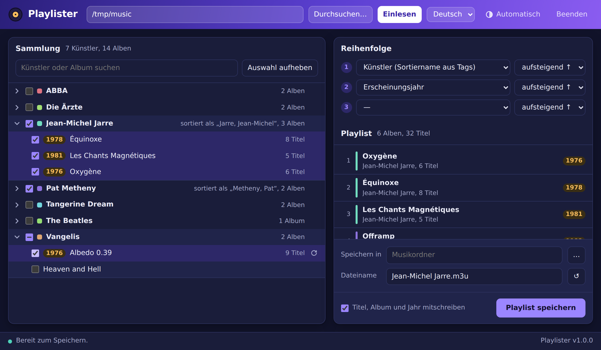

# Playlister

*[English version](README.md)*

Playlister erstellt M3U-Playlists aus einer Musiksammlung im Aufbau
`Künstler/Album/Titel`. Du wählst Künstler und Alben im Browser aus, legst die
Reihenfolge der Alben fest und speicherst die Playlist neben deiner Musik. Die
Pfade sind relativ zur Playlist, sie funktioniert also auch auf einem NAS, über
einen DLNA-Server oder auf einem anderen Rechner.



## Funktionen

- **Schnell auch bei großen Sammlungen:** Beim Einlesen werden nur Ordner
  gelistet. Die Tags eines Albums werden erst gelesen, wenn du es auswählst.
  Auch eine große Sammlung auf einer Netzwerkfreigabe ist so in Sekunden da.
- **Flexible Reihenfolge:** bis zu drei Sortierkriterien, jeweils auf- oder
  absteigend: Künstler (Ordnername, Name aus Tags oder Sortiername aus Tags),
  Erscheinungsjahr, Albumtitel. Alben ohne Jahr stehen immer am Ende.
- **Liest Tags aus MP3 (ID3v2.3/2.4) und AAC (.m4a, .m4p, .m4b)**, darunter
  Erscheinungsjahr, Track- und Disc-Nummer und die Sortiernamen
  (TSOP/TSO2, soar/soaa).
- **Relative Pfade mit `/`** als Trenner, wie es die meisten Player und
  DLNA-Server erwarten.
- **Optional erweitertes M3U** mit `#EXTINF` (Interpret – Titel) sowie
  `#EXTART` und `#EXTALB` samt Erscheinungsjahr.
- **Einzelnes Album oder einzelnen Künstler neu einlesen**, z. B. nach dem
  Bearbeiten der Tags. Die Auswahl bleibt erhalten.
- **Dateinamen-Vorschlag** aus den gewählten Künstlern (Ordner- oder
  Sortiername).
- Oberfläche auf Deutsch und Englisch, helles und dunkles Erscheinungsbild.
- Ein einziges, eigenständiges Programm für macOS, Linux und Windows. Keine
  Laufzeitumgebung, keine Installation, die Oberfläche läuft im Browser.

## Download

Lade die Datei für dein System von der
[Releases](https://github.com/Skeeve/playlister/releases)-Seite:

| System                    | Datei                             |
|---------------------------|-----------------------------------|
| macOS (Apple Silicon)     | `playlister-macos-arm64.tar.gz`   |
| macOS (Intel)             | `playlister-macos-amd64.tar.gz`   |
| Linux (x86_64 / ARM64)    | `playlister-linux-amd64.tar.gz` / `playlister-linux-arm64.tar.gz` |
| Windows                   | `playlister-windows-amd64.zip`    |

**macOS:** Das Programm ist nicht von Apple signiert. Entferne nach dem
Entpacken einmalig die Quarantäne-Markierung, sonst verweigert Gatekeeper den
Start:

```sh
xattr -d com.apple.quarantine playlister-macos-arm64
```

## Bedienung

Starte das Programm per Doppelklick oder im Terminal. Es öffnet
`http://127.0.0.1:8765/` in deinem Standardbrowser.

1. Musikordner eingeben oder per „Durchsuchen…“ wählen, dann **Einlesen**.
2. Künstler und/oder Alben anhaken. Ein Häkchen beim Künstler wählt alle seine
   Alben.
3. Reihenfolge festlegen. Die Vorschau rechts zeigt die Playlist so, wie sie
   gespeichert wird.
4. Zielordner und Dateinamen wählen, dann **Playlist speichern**.

**Beenden** in der Kopfzeile oder Strg+C im Terminal beendet das Programm.

Erwarteter Aufbau – Alben dürfen Unterordner wie `CD1`/`CD2` enthalten:

```
Musik/
├── Jean-Michel Jarre/
│   ├── Oxygène/
│   │   ├── 01 Oxygène Part I.mp3
│   │   └── …
│   └── Équinoxe/
└── Pat Metheny/
    └── Offramp/
```

Ergebnis (gespeichert in `Musik/`):

```
#EXTM3U
#EXTART:Jean-Michel Jarre
#EXTALB:Oxygène (1976)
#EXTINF:-1,Jean-Michel Jarre - Oxygène Part I
Jean-Michel Jarre/Oxygène/01 Oxygène Part I.mp3
```

### Kommandozeilen-Optionen

| Option | Standard | Bedeutung |
|--------|----------|-----------|
| `-listen` | `127.0.0.1:8765` | Adresse und Port des Webservers. Ist der Standard-Port belegt, wird ein freier genommen. |
| `-no-browser` | aus | Browser nicht automatisch öffnen. |
| `-version` | | Version ausgeben und beenden. |

### Betrieb auf einem Server

Du kannst Playlister direkt auf dem Rechner laufen lassen, auf dem die Musik
liegt, z. B. neben einem DLNA-Server, und es von einem anderen Rechner aus
bedienen:

```sh
./playlister-linux-amd64 -listen 0.0.0.0:8765 -no-browser
```

Es gibt keine Anmeldung: Wer den Port erreicht, kann Ordner durchsuchen und
Playlists schreiben. Gib ihn nur in einem vertrauenswürdigen Netz frei.

Die Einstellungen liegen im Konfigurationsordner des Benutzers
(`~/Library/Application Support/playlister/` unter macOS,
`~/.config/playlister/` unter Linux, `%AppData%\playlister\` unter Windows).

## Selbst bauen

Nötig ist nur Docker, keine Go-Installation:

```sh
docker build --output dist .
docker build --build-arg VERSION=v1.0.0 --output dist .   # mit Versionsnummer
```

Das führt `go vet` und die Tests aus und legt die Programme für alle Plattformen
in `dist/` ab. Mit installiertem Go (ab 1.22) geht wie üblich `go build .`.

Releases baut GitHub Actions: Ein Tag `v*` erzeugt ein Release mit allen
Programmdateien.

## Weitere Sprache hinzufügen

Alle Texte stehen in `web/index.html` im Objekt `I18N`. Kopiere den Block `en`,
übersetze die Werte und ergänze eine `<option>` in der Sprachauswahl
(`#langSel`). Pull Requests sind willkommen.

## Hinweise

- `.m4p`-Dateien sind iTunes-Käufe, die noch kopiergeschützt sein können
  (FairPlay). Playlister nimmt sie wie jede andere Datei auf, geschützte Titel
  spielen aber nur auf von Apple autorisierten Geräten.
- Ordner und Dateien, die mit einem Punkt beginnen, werden ignoriert, auch die
  `._*`-Dateien, die macOS auf Netzwerkfreigaben und FAT/exFAT-Laufwerken anlegt.

## Danksagung

Geschrieben von Claude (Anthropic) im Gespräch mit
[Stephan (Skeeve)](https://github.com/Skeeve), von dem die Idee stammt und der
es an einer echten Sammlung getestet hat. Tags von MP3-Dateien werden mit
[dhowden/tag](https://github.com/dhowden/tag) gelesen.

## Lizenz

[MIT](LICENSE)
