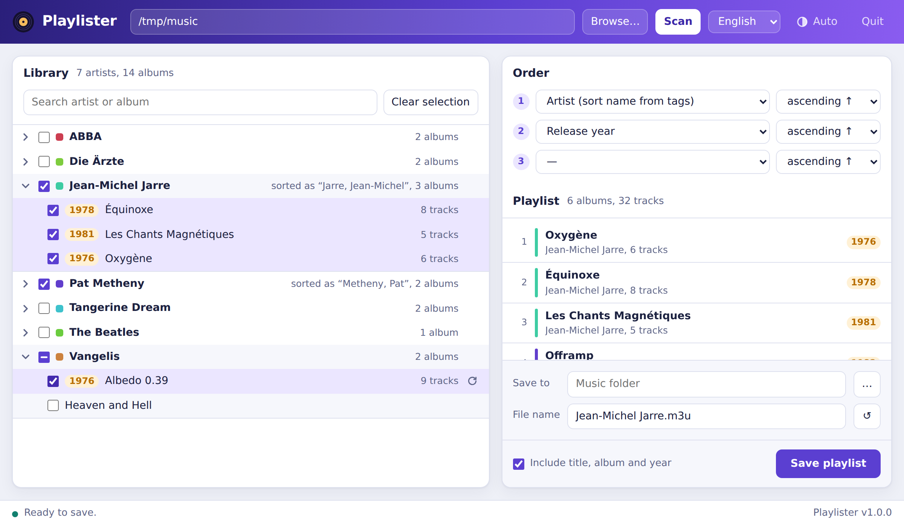

# Playlister

*[Deutsche Version](README.de.md)*

Playlister creates M3U playlists from a music collection organized as
`Artist/Album/Tracks`. Pick artists and albums in your browser, choose how the
albums should be ordered, and save the playlist next to your music – with paths
relative to the playlist, so it keeps working on a NAS, a DLNA server or a
different computer.



## Features

- **Fast with big collections:** scanning only lists folders. Tags are read
  when you select an album, so even a large library on a network share opens
  in seconds.
- **Flexible ordering:** up to three sort levels, each ascending or
  descending: artist (folder name, name from tags or sort name from tags),
  release year, album title. Albums without a year always go last.
- **Reads tags from MP3 (ID3v2.3/2.4) and AAC (.m4a, .m4p, .m4b)**, including
  release year, track and disc numbers and artist sort names
  (TSOP/TSO2, soar/soaa).
- **Relative paths with `/`** as separator, as most players and DLNA servers
  expect.
- **Optional extended M3U** with `#EXTINF` (artist – title) plus `#EXTART` and
  `#EXTALB` including the release year.
- **Rescan a single album or artist** after editing tags – your selection stays.
- **File name suggestion** from the selected artists (folder or sort name).
- German and English user interface, light and dark theme.
- A single, self-contained program for macOS, Linux and Windows. No runtime,
  no installation; the interface runs in your browser.

## Download

Get the binary for your system from the
[Releases](https://github.com/Skeeve/playlister/releases) page:

| System                    | File                              |
|---------------------------|-----------------------------------|
| macOS (Apple Silicon)     | `playlister-macos-arm64-app.zip` (app) or `playlister-macos-arm64.tar.gz` (command line) |
| macOS (Intel)             | `playlister-macos-amd64-app.zip` (app) or `playlister-macos-amd64.tar.gz` (command line) |
| Linux (x86_64 / ARM64)    | `playlister-linux-amd64.tar.gz` / `playlister-linux-arm64.tar.gz` |
| Windows                   | `playlister-windows-amd64.zip`    |

**macOS:** use `Playlister.app` from the `-app.zip` and move it to your
Applications folder. It is not signed by Apple, so remove the quarantine flag
once, otherwise Gatekeeper refuses to start it:

```sh
xattr -dr com.apple.quarantine /Applications/Playlister.app
```

Why the app? macOS asks for permission before a program may read network
volumes, external drives or your Documents, Desktop and Downloads folders – and
it asks on behalf of the program that *started* Playlister. Launched from the
terminal of an editor such as VS Code, the plain binary fails with
"operation not permitted" unless that editor has the permission. The app is
its own program for macOS: it asks once for itself and works no matter how
you start it.

## Usage

Start the program – on macOS double-click `Playlister.app` or run
`open /Applications/Playlister.app`. It opens `http://127.0.0.1:8765/` in your
browser. If Playlister is already running, starting it again just opens the
browser. The browser can be chosen in the settings (gear icon); by default the
system's default browser is used.

1. Enter or browse to your music folder and click **Scan**.
2. Tick artists and/or albums. Ticking an artist selects all of its albums.
3. Choose the order. The preview on the right shows the playlist as it will
   be saved.
4. Pick the target folder and file name, then **Save playlist**.

**Quit** in the header (or Ctrl+C in the terminal) stops the program. On
macOS, the app also shows a Dock icon; Quit from its Dock menu works the same
way.

Expected layout – albums may contain subfolders such as `CD1`/`CD2`:

```
Music/
├── Jean-Michel Jarre/
│   ├── Oxygène/
│   │   ├── 01 Oxygène Part I.mp3
│   │   └── …
│   └── Équinoxe/
└── Pat Metheny/
    └── Offramp/
```

Resulting playlist (saved in `Music/`):

```
#EXTM3U
#EXTART:Jean-Michel Jarre
#EXTALB:Oxygène (1976)
#EXTINF:-1,Jean-Michel Jarre - Oxygène Part I
Jean-Michel Jarre/Oxygène/01 Oxygène Part I.mp3
```

### Command-line options

| Option | Default | Meaning |
|--------|---------|---------|
| `-listen` | `127.0.0.1:8765` | Address and port of the web server. If the default port is taken, a free one is used. |
| `-no-browser` | off | Don't open the browser automatically. |
| `-browser` | from settings | Browser to open: on macOS the application name (`Firefox`, `Google Chrome`), on Windows the program name (`firefox`, `msedge`), on Linux the command (`firefox`). |
| `-version` | | Print the version and exit. |

With the app, pass options like this:
`open /Applications/Playlister.app --args -browser Firefox`

### Running on a server

You can run Playlister directly on the machine that stores the music, e.g. next
to a DLNA server, and use it from another computer:

```sh
./playlister-linux-amd64 -listen 0.0.0.0:8765 -no-browser
```

There is no authentication – anyone who can reach the port can browse folders
and write playlists. Only expose it in a network you trust.

Settings are stored in the user configuration folder
(`~/Library/Application Support/playlister/` on macOS,
`~/.config/playlister/` on Linux, `%AppData%\playlister\` on Windows).

## Building

Only Docker is required – no Go installation:

```sh
docker build --output dist .
docker build --build-arg VERSION=v1.0.0 --output dist .   # with version number
```

This runs `go vet` and the tests and writes binaries for all platforms to
`dist/`, plus the macOS apps in `dist/app-arm64/` and `dist/app-amd64/`.
macOS should sign a self-built app once (ad hoc, no Apple account needed;
`codesign` is part of macOS):

```sh
codesign --force --sign - --identifier io.github.skeeve.playlister dist/app-arm64/Playlister.app
```

Every new build is a new program for macOS, so it asks for the folder
permissions again on first start.

With a local Go installation (1.22+), `go build .` works as usual.

Releases are built by GitHub Actions: pushing a tag `v*` creates a release with
all binaries attached.

## Adding a language

All texts live in `web/index.html` in the `I18N` object. Copy the `en` block,
translate the values and add an `<option>` to the language selector
(`#langSel`). Pull requests are welcome.

## Notes

- `.m4p` files are iTunes purchases that may still be copy-protected
  (FairPlay). Playlister lists them like any other file, but protected tracks
  only play on devices authorized by Apple.
- Folders and files starting with a dot are ignored, including the `._*`
  files macOS creates on network shares and FAT/exFAT drives.

## Credits

Written by Claude (Anthropic), in conversation with
[Stephan (Skeeve)](https://github.com/Skeeve), who had the idea and tested it on
a real collection. Tags of MP3 files are read with
[dhowden/tag](https://github.com/dhowden/tag).

## License

[MIT](LICENSE)
